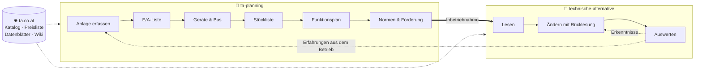
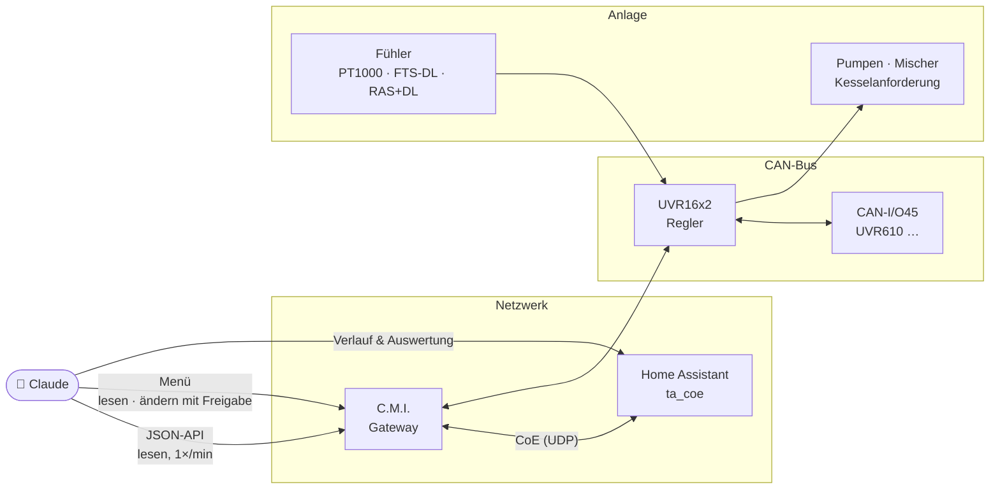

<div align="center">

# 🔥 ta-skills

**Claude-Skills für Heizungsregelungen von Technische Alternative**

Planen · in Betrieb nehmen · betreiben · auswerten — UVR16x2, UVR610, UVR67, C.M.I. und Home Assistant


</div>

---

## Worum es geht

Eine TA-Regelung ist frei programmierbar und deshalb mächtig – und genauso leicht falsch geplant,
falsch parametriert oder unbemerkt kaputt. Diese Skills geben Claude das Wissen und die
Arbeitsweise, um dabei zu helfen: **für Eigentümer, die ihre eigene Anlage verstehen und
verbessern wollen, und für Installateure, die eine neue planen.**

| | Skill | Wofür |
|:-:|---|---|
| 📐 | [**`ta-planning`**](skills/ta-planning/SKILL.md) | Neue oder umgebaute Anlage planen: E/A-Liste, Geräteauswahl, Busplan, Stückliste mit Artikelnummern und Datenblättern, Funktionsplan, Normen und Förderung in Österreich |
| 🔧 | [**`technische-alternative`**](skills/technische-alternative/SKILL.md) | Bestehende Anlage betreiben: Werte lesen (JSON-API, CoE), Parameter sicher ändern (C.M.I.-Menü, TAPPS2), Funktionen verstehen, Messdaten auswerten |

## So greifen die Teile ineinander



## Der Weg zur Anlage

Woher Claude seine Werte bekommt und wo es eingreifen kann:



## Was drin ist

<details>
<summary><b>📐 ta-planning</b> – Planung in acht Schritten</summary>

```
skills/ta-planning/
├── SKILL.md                 Planungsablauf, Zielgruppen, Grenzen
├── assets/plan-template.md  Vorlage für den Planungsbericht
└── references/
    ├── catalog.md           Produktseiten, Katalog, Preisliste, Datenblatt-IDs, Programmbibliothek
    ├── devices.md           Regler und Module im Vergleich, Grenzen, Schnittstellen
    ├── sensors-actuators.md Fühler, Tauchhülsen, Durchfluss, Pumpen, Mischer, Hilfsrelais
    ├── bus-design.md        CAN- und DL-Bus: Topologie, Länge, 12-V-Budget, Buslast
    ├── austria.md           Normen, OIB-Richtlinien, Landesrecht OÖ, Förderung 2026
    └── example-plan.md      Durchgerechnetes Beispiel mit Erfahrungen aus dem Betrieb
```

</details>

<details>
<summary><b>🔧 technische-alternative</b> – Betrieb und Auswertung</summary>

```
skills/technische-alternative/
├── SKILL.md                 Arbeitsweise, Wege zum Gerät, Fallstricke, Sicherheitsregeln
├── references/
│   ├── json-api.md          C.M.I. JSON-API: Parameter, Statuscodes, Einheiten
│   ├── coe.md               CAN over Ethernet, Home Assistant in beide Richtungen
│   ├── cmi-menu.md          UVR-Menü über das C.M.I. lesen und ändern (beobachtetes Protokoll)
│   ├── tapps2.md            Funktionsdaten ändern, versionieren, übertragen
│   ├── functions.md         Heizkreis, Anforderung, Ladepumpe, Solar, Legionellen, WMZ …
│   ├── operation.md         Benutzerebenen, Uhrzeit/NTP, Logging, CAN
│   └── analysis.md          Speicherinhalt, Bedarfsmodell, Heizkurve, Kesselphasen, Verluste
└── scripts/
    └── cmi_menu.py          Menüseiten lesen, Werte mit Prüfung und Rücklesung setzen
```

</details>

## Installation

```bash
git clone https://github.com/dbuchber/ta-skills.git
ln -s "$PWD/ta-skills/skills/ta-planning"            ~/.claude/skills/ta-planning
ln -s "$PWD/ta-skills/skills/technische-alternative" ~/.claude/skills/technische-alternative
```

Danach erkennt Claude Code die Skills von selbst – etwa bei *„Welchen Regler brauche ich für zwei
Heizkreise und Solar?“* oder *„Senk die Heizkurve um 2 K und prüf, ob es wirkt.“*

## Beispiele

| Frage | Skill |
|---|---|
| „Ich tausche meinen Ölkessel gegen Pellets – welche TA-Regelung, welche Fühler, was kostet das, welche Förderung gibt es?“ | 📐 |
| „Mach mir eine Stückliste für Puffer, Boiler, Solar und drei Heizkreise mit Datenblatt-Links.“ | 📐 |
| „Wie viel Energie steckt gerade im Puffer, und reicht sie bis morgen?“ | 🔧 |
| „Warum kommt die Kesselanforderung bei Frost zu spät?“ | 🔧 |
| „Bring die Vorlauf-Sollwerte der UVR als Sensoren nach Home Assistant.“ | 🔧 |

## Grundsätze

> [!IMPORTANT]
> **Erst lesen, dann ändern.** Jede Schreibaktion am Regler braucht die Freigabe des Betreibers,
> wird zurückgelesen und an einer Ausgangsgröße nachgewiesen.

- 🔐 **Zugangsdaten** nur über Umgebungsvariablen oder stdin – nie in Kommandozeilen oder Dateien.
- 📚 **Quellen:** Das [TA-Wiki](https://wiki.ta.co.at) ist Primärquelle; der Skill verweist darauf
  und schlägt Details dort nach. Was nur am Gerät beobachtet wurde (das Menüprotokoll des C.M.I.),
  ist als solches gekennzeichnet.
- 📅 **Stand November 2026:** Preise, Normausgaben und Förderbedingungen ändern sich – vor
  Verwendung prüfen.
- ⚖️ **Keine Rechtsberatung.** Verantwortung für Planung und Ausführung trägt der befugte
  Fachbetrieb.

## Sprache

Die Skills sind auf **Englisch** geschrieben, damit Claude sie in jeder Sprache nutzt;
Parameternamen stehen so, wie TA sie am Gerät zeigt (deutsch). Fragen auf Deutsch funktionieren.

---

<sub>Kein offizielles Produkt der Technische Alternative RT GmbH. Markennamen gehören ihren Inhabern. · Lizenz: MIT</sub>
